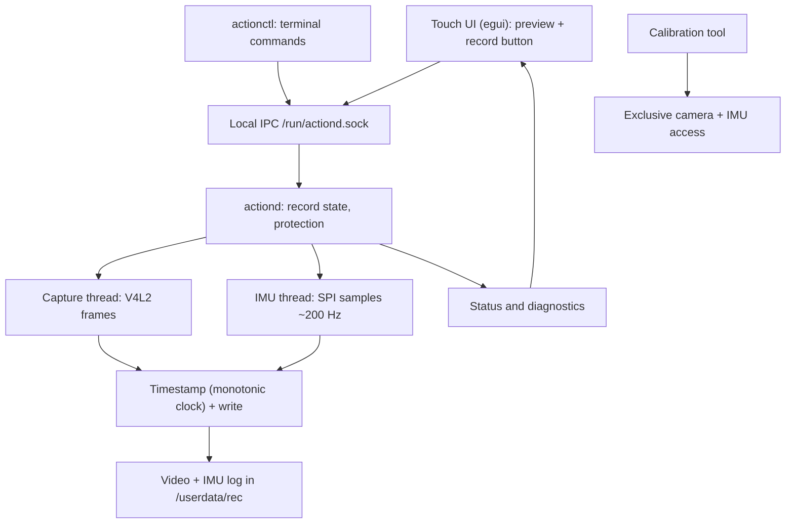

# tspi-action-rs

[](LICENSE)
[](https://github.com/K12231217/tspi-action-rs)

**A Rust reimplementation of the TspiAction handheld action camera concept, running on the LCKFB Taishan Pi (RK3566). It records video and IMU data in sync on the board; stabilisation is done offline on a PC.**

> **Status: early development, demo scope.** This README describes the intended design. Features marked *Planned* are not implemented yet; only the items marked *Done* have actually run on hardware.

## Open-source projects and resources

| Resource | Contents |
|---|---|
| TspiAction (concept source) | Handheld action camera on Taishan Pi: 2.3″ touchscreen, IMU post-stabilisation, 8 MP photo, 1080p video. Original hardware/software links not found; see the attribution note below. |
| This repository | On-board recording daemon, touch UI, CLI, calibration tool, deployment scripts |
| Gyroflow | Offline gyro-based video stabilisation (Rust) |
| EasyDuck | Project architecture reference: daemon + local IPC + calibration handoff on the same board |

## Features

| Feature | Description |
|---|---|
| Synchronised recording | Video frames and IMU samples share one monotonic clock, written together for offline stabilisation |
| SPI IMU sampling | IMU660RB at ~200 Hz; gyroscope + accelerometer, raw values only |
| USB camera capture | MJPEG straight from the camera — no encoder needed for the demo |
| Touch UI | Live preview, start/stop recording, recording status |
| Calibration tool | Camera intrinsics + camera–IMU extrinsics and time offset, stored per device |
| Storage protection | Recording stops before the disk fills; the system stays alive |
| MIPI camera support | OV5695 via the board's CSI seat (hardware ordered) |

## Getting started

### Hardware

| Component | Supported configuration |
|---|---|
| Controller | Taishan Pi 1M, RK3566, ARM64 Linux with systemd |
| MIPI camera | OV5695, 30-pin 0.5 mm MIPI CSI, 5 MP |
| USB camera | Generic UVC camera (MJPEG) on `/dev/video*` |
| IMU | IMU660RB 6-axis module on SPI3 (`/dev/spidev3.0`) |
| Touchscreen | Waveshare 3.5″ HDMI capacitive touch LCD, 480×800 IPS, USB-C touch |
| Storage | Recordings go to `/userdata/rec`, never to the 6 GB root partition |

The MIPI camera must be the **30-pin 0.5 mm** variant for the Taishan Pi. A 24-pin module (e.g. OV5640) does not fit the board's CSI seat. The screen is HDMI + USB touch (driver-free). SPI screens are deliberately avoided: they need a panel driver and would compete with the IMU for the board's single SPI bus.

OV5695 is 5 MP, not the original's 8 MP. 8 MP MIPI options for this board are unverified; 5 MP is the documented, manual-tested choice.

### First recording

1. Assemble the hardware: camera on the CSI seat (or USB camera plugged in), IMU660RB wired to SPI3, touchscreen on Micro HDMI + USB.
2. Install the applications on the board (see Build the applications).
3. Run the calibration tool once and save the device calibration. Recording without it still works, but offline stabilisation will be poor.
4. Open the touch UI, check the preview, and press record. A short clip and its IMU log appear in `/userdata/rec`.
5. Copy the clip to a PC and stabilise it with Gyroflow.

### Build the applications

Build on a Windows PC with cross-compilation — do not build on the board (2 GB RAM is not enough for `rustc`).

```bash
bash deploy/build.sh
```

`deploy/build.sh` uses `cargo-zigbuild` (Zig as the cross linker) to target `aarch64-unknown-linux-gnu`; binaries are written to `build/bin/`. To run the build steps manually:

```bash
cargo install cargo-zigbuild
rustup target add aarch64-unknown-linux-gnu
cargo zigbuild --release --target aarch64-unknown-linux-gnu
```

A Linux PC or WSL2 works too: install `gcc-aarch64-linux-gnu` and run `cargo build --release --target aarch64-unknown-linux-gnu` instead. The board SDK is not needed; this repository's installer handles application files and service integration.

## Architecture

`tspi-action-rs` centers on `actiond`: the touch UI and CLI send record requests, the daemon owns the camera, IMU, and storage, and the recorder writes synchronised video + IMU data. Calibration and service management support this record chain.

### Components and responsibilities



| Component | Responsibility | Source |
|---|---|---|
| Touch UI | Live preview, record start/stop, status display | `runtime/ui/` |
| `actionctl` | Terminal control, status inspection, and diagnostics | `runtime/actionctl/` |
| `actiond` | Own record state, run capture + IMU threads, enforce storage protection | `runtime/actiond/` |
| Capture / IMU library | V4L2 frame capture, SPI IMU sampling, timestamping, file writing | `runtime/action-core/` |
| Calibration tool | Camera intrinsics, camera–IMU extrinsics, time offset, IMU bias | `calibration/` |
| `deploy/` | Cross build, installation, rollback, systemd units | `deploy/` |

`action-ipc` defines inter-process messages and `action-config` parses configuration. These shared crates compile into the programs and do not run as separate services.

### From button press to file

When the operator presses record, the touch UI sends a start request to `actiond` through the local Unix socket. The daemon checks record state and storage headroom before accepting it; the UI never touches hardware directly.

The record loop targets **30 fps video and ~200 Hz IMU sampling**. Each frame and each sample is stamped with the same monotonic clock (`CLOCK_MONOTONIC`) and written together, so the gyro trace lines up with the video during offline stabilisation. Linux scheduling and USB/SPI timing affect actual rates; these are targets, not hard real-time guarantees.

| Record data | Rate (target) | Purpose |
|---|---|---|
| Video frames (MJPEG) | 30 fps | The picture |
| Gyroscope (3-axis) | ~200 Hz | Rotation for stabilisation |
| Accelerometer (3-axis) | ~200 Hz | Gravity direction + motion context |
| Monotonic timestamps | per frame/sample | Align gyro trace to video |

Stopping a recording closes the files and writes an index (start time, frame count, sample count, calibration file used). A stop request is not proof that every buffered frame reached disk if power is lost mid-write.

### Ownership and hardware access

During normal operation, `actiond` exclusively owns the camera device, `/dev/spidev3.0`, and the record directory. The touch UI, `actionctl`, and any future client submit requests through local IPC; the daemon decides what runs.

**A running daemon, a UI ready for input, and a recording in progress are different states.** Starting the service does not start a recording. Recording state and storage protection are separate: a full disk blocks new recordings but does not stop the daemon or the UI.

### Calibration and configuration handoff

Calibration needs direct camera and IMU access, so it runs separately from normal recording. Systemd unit conflicts prevent the calibration tool and `actiond` from running concurrently.

The usual sequence is: **stop recording → let calibration take ownership → save device calibration → leave calibration → reopen recording with the saved calibration**. Saving does not live-reconfigure an already running daemon; leaving calibration restarts the recording service so it reopens hardware and reads the saved data.

`actiond.toml` holds hardware, paths, and runtime settings; `calibration.json` holds camera intrinsics, camera–IMU extrinsics, time offset, and IMU bias. Calibration maps the physical installation into shared software coordinates.

### Startup and runtime protection

Linux `systemd` manages services, starts programs, restarts them after exits according to their unit settings, and retains logs. It manages process lifetime; `actiond` handles record state, storage checks, and related runtime logic. Process restart does not cover every hang or hardware failure.

Storage protection leaves Linux running: when free space in `/userdata` falls below the configured headroom, the daemon stops the current recording cleanly instead of filling the disk. A protection stop is not proof that the last seconds of video were flushed if the disk itself is failing.

### System and extension boundaries

The board image supplies Linux, V4L2 camera drivers, spidev, and system components. This repository supplies applications, configuration, and application deployment. Installing application files does not install a matching kernel driver.

New clients can reuse the daemon IPC interface. A replacement camera needs a capture adapter with consistent pixel format, frame rate, and timestamp handling. A replacement IMU needs a driver adapter with consistent units, coordinates, installation calibration, and freshness handling. Offline stabilisation is maintained separately; this repository does not contain a stabiliser.

The IPC socket is local-only. If a web UI is added later, do not expose its ports to the Internet; the daemon interface has no account authentication.

## Documentation

| Goal | Read |
|---|---|
| Install, configure, and operate | `docs/software-guide.md` (planned) |
| Build, install, or roll back applications | `docs/deployment.md` (planned) |
| Calibrate camera and IMU | `docs/calibration.md` (planned) |
| Understand the record file format | `docs/record-format.md` (planned) |

## Repository layout

| Directory | Responsibility |
|---|---|
| `runtime/` | Rust daemon, touch UI, CLI, and shared libraries |
| `calibration/` | Camera/IMU calibration tool |
| `config/` | Public configuration templates and board parameters |
| `deploy/` | Cross build, installation, rollback, services |
| `docs/` | Paired English and Chinese guides |
| `tools/` | Development tools and repository checks |

## Contributing

Issues and improvements are welcome. Include hardware, configuration, reproduction steps, and logs in reports. Run the relevant checks before submitting code. Keep private calibration, credentials, and build outputs outside the repository.

## Acknowledgments and license

The project architecture — daemon owning hardware, local IPC for clients, and a separate calibration tool with exclusive hardware access — follows [EasyDuck](https://github.com/jlckfb/easyduck) (Apache-2.0), the Taishan Pi biped robot project by the LCKFB team. Thanks to that project and its contributors.

The root project license is MIT OR Apache-2.0, at your option. Third-party content retains its own terms. See `LICENSE-MIT` and `LICENSE-APACHE`.

## References

Only projects and libraries this build actually uses or follows. Nothing else is listed.

- [TspiAction — 泰山派高清防抖运动相机](https://search.bilibili.com/zh-Hans/all?keyword=tspi) (Bilibili, 2025-12-20) and [secondary coverage](https://post.smzdm.com/p/awwdgr34/) — the concept being reimplemented. Original hardware/software links not found; this is a clean-room reimplementation, not a fork.
- [EasyDuck](https://github.com/jlckfb/easyduck) — architecture reference: `robotd` daemon, local IPC, calibration handoff, systemd services, on the same board.
- [Gyroflow](https://github.com/gyroflow/gyroflow) — gyro-based video stabilisation (Rust). The offline stabilisation reference.
- [rknn_cam_rtsp](https://github.com/shum-elli/rknn_cam_rtsp) — USB camera + MPP H.264 encode on RK3566. Closest reference for the capture/encode pipeline. (Built on Radxa Zero 3, not Taishan Pi.)
- Crates: [`v4l`](https://crates.io/crates/v4l) / [`gstreamer-rs`](https://crates.io/crates/gstreamer) (capture), [`spidev`](https://crates.io/crates/spidev) (IMU), [`egui`](https://crates.io/crates/egui) + [`eframe`](https://crates.io/crates/eframe) (UI).
