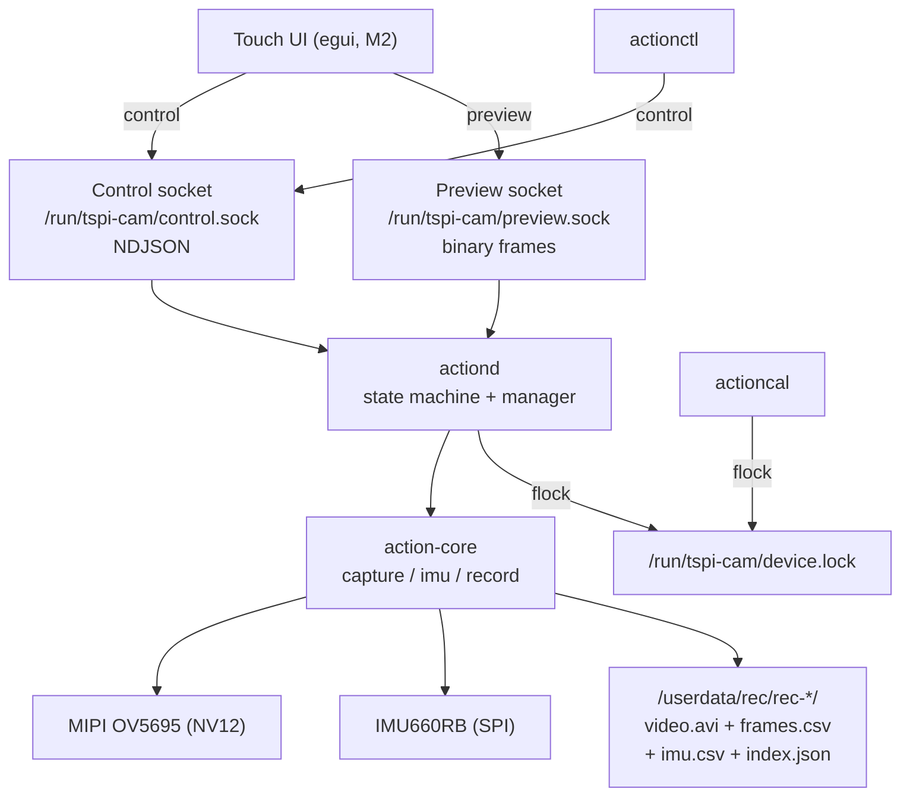
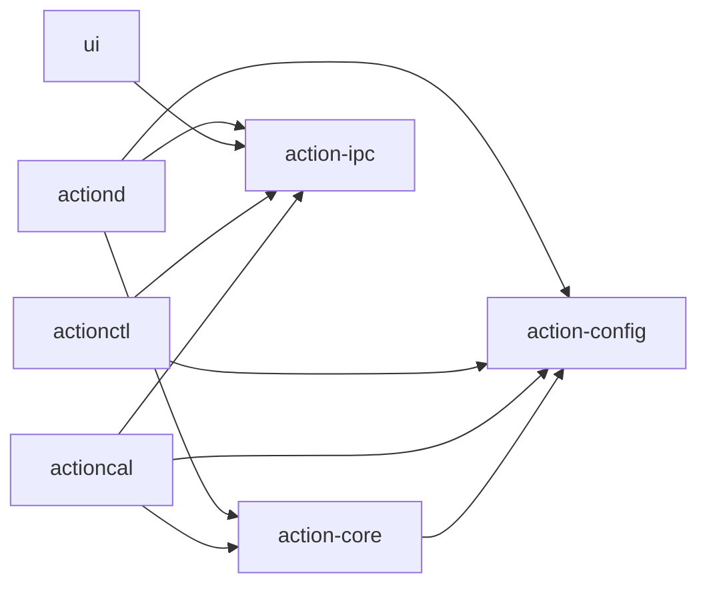
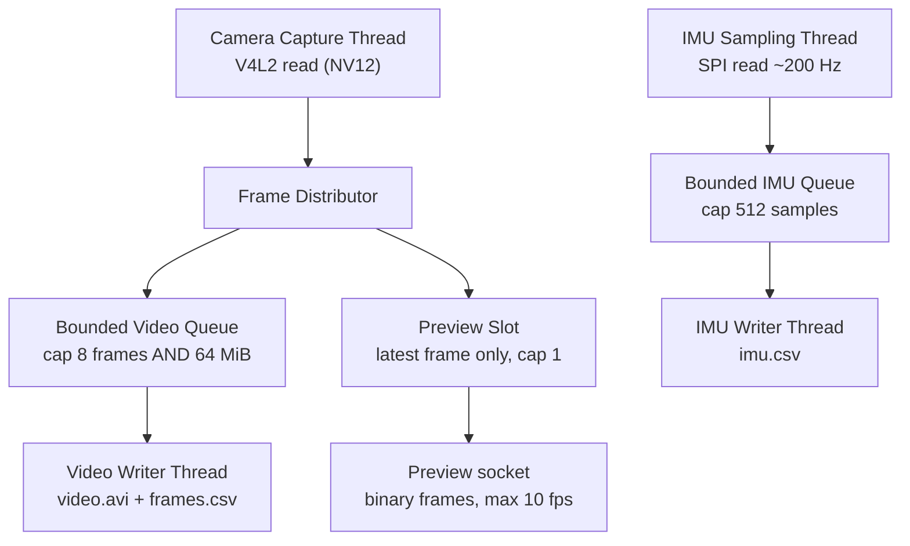
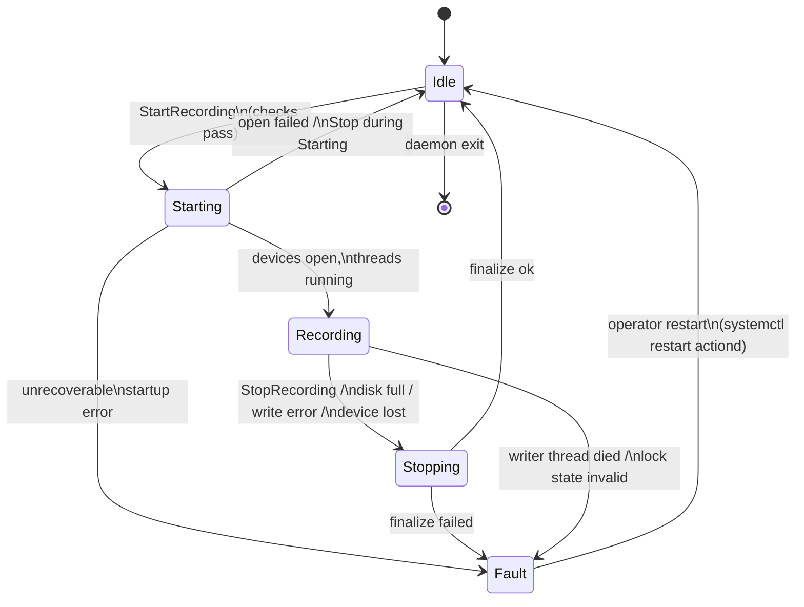

# tspi-cam 架构 v1.2

- 状态：v1.2（2026-11-12 23:07），修订 v1.1。
- 适用范围：立创泰山派 1M 开发板上的 Rust 视觉惯性数据采集系统，Demo 工程完整性目标。
- 参考架构：[EasyDuck](https://github.com/jlckfb/easyduck)（同板卡，Daemon + 本地 IPC + 标定交接）。
- 语言：本文档为中文工作版；公开 README 为英文，两者出现冲突时以本文档为准。

> **SoC 更正：** 修订提示词初稿写 RK3568，与实测板卡不符。实测为 **RK3566**
>（泰山派 1M，4× Cortex-A55）。本文档一律写 RK3566；凡提示词中写 RK3568 之处均按此更正。
> 未经实测的硬件能力一律标注 `TODO: Hardware Verification`，不臆造。

## 0. 修订记录

### v1.2（2026-11-12 23:07，用户决定：完全跳过 USB）

| # | 变更 | 原因 |
|---|---|---|
| 13 | M1 **完全跳过 USB**，相机只走 MIPI NV12；NV12 编码路径（GStreamer `jpegenc`）进入 M1 | 用户决定；USB 不再是任何阶段的路径 |
| 14 | M1 分 A/B 两段：A 段不依赖相机，可立即开始；B 段等 OV5695 模块到货 | 模块未到货，M1 不应整体阻塞；非相机部分可先行 |
| 15 | 硬件验证清单删除 USB 两项（原 H2/H3），重排为 H1–H9；H8（OV5695 到货）成为 M1 的门 | USB 不再验证 |

### v1.1（2026-11-12 23:04，用户反馈）

| # | 变更 | 原因 |
|---|---|---|
| 10 | Camera 主路改为 MIPI NV12（OV5695），USB MJPEG 降为到货前的过渡验证路径；MIPI 带入与 NV12 编码路径由 M3 提前到 M2 | 产品相机是 MIPI；USB 只是手头能立即验证的替身 |
| 11 | Video 队列上限由“8 帧”改为“8 帧且 64 MiB，先到为准” | NV12 单帧约 3 MiB，纯帧数上限管不住内存；64 MiB 为工程直觉，**未经验证**（H9） |
| 12 | `imu.max_dropped` 的“100”明确为双条件：任意 10 s 窗口内累计丢样 > 100，或连续丢样 > 50 | 原“100”未定义是累计、连续还是窗口内；累计值对长录制无意义，窗口速率才能反映管线跟不上 |

### v1.0 相对草稿的主要变更

| # | 变更 | 原因 |
|---|---|---|
| 1 | Daemon 内增加 `manager.rs`，统一协调 Camera / IMU / Writer 生命周期；录制状态机只在 Daemon 内维护一份 | 草稿未明确谁协调生命周期，Core 与 Daemon 易各自维护状态 |
| 2 | 数据管线改为生产者—消费者：有界队列 + 独立 Video / IMU Writer + Frame Distributor + Latest Frame 预览 | 采集线程不得做写盘；视频与 IMU 写入隔离；预览不得反压 Recorder |
| 3 | 时间戳设计重写：区分 5 个时间点，优先用 V4L2 驱动时间戳并核查时钟域；内部单位统一 rad/s、m/s²；增加 `frames.csv` | 时间同步是本项目核心，草稿只有一句话 |
| 4 | 状态机由 3 态扩为 5 态：Idle / Starting / Recording / Stopping / Fault，并定义异常分级 | 草稿无法表达启动失败、停止中请求、Finalize 失败 |
| 5 | 标定互斥由“lock 文件存在与否”改为 `flock()` 独占锁 `/run/tspi-cam/device.lock` | 进程崩溃后锁文件残留会误判占用；flock 由内核释放 |
| 6 | IPC 拆为控制平面（Unix Socket + NDJSON）与数据平面（独立 Unix Socket + 二进制帧协议）；废弃 Base64 JSON 预览 | 控制与数据分离；Base64 只是临时方案 |
| 7 | 增加统一 Camera 抽象：`Frame` + `PixelFormat` + `CaptureAdapter`，预留 NV12/YUYV | 草稿默认一切输入都是 MJPEG，会堵死 MIPI 扩展 |
| 8 | 数据完整性：`index.json` 临时文件 + 原子重命名，未完成记录可识别；增加运行指标表 | 草稿无法区分完整记录与异常中断的记录 |
| 9 | 明确 M1 / M2 / M3 边界与 M1 实现顺序、硬件验证清单 | 草稿无版本规划 |

已废弃的草稿设计：单 Socket 上的 Base64 预览、lock 文件存在性互斥、3 态状态机、
“Core 与 Daemon 各自维护状态”的模糊分工、USB 相机路径。本文档以下内容取代它们。

## 1. 目标与非目标

### 1.1 目标

在 RK3566 + Ubuntu 20.04 上，用 Rust 实现一个具备工程完整性的视觉惯性数据采集系统：

1. 多传感器时间同步（Camera + IMU，同一时间基准）。
2. 高可靠性实时采集与写盘（采集不停顿，写盘可追溯）。
3. Linux Daemon 与 IPC 设计（守护进程中心，客户端请求制）。
4. Rust 模块化架构与硬件抽象（可换 Camera / IMU，不改业务）。
5. 设备生命周期管理与异常恢复（状态机、互斥、保护）。
6. 数据完整性、可追溯性与离线处理兼容性（原始数据可恢复，PC 端做防抖）。

### 1.2 非目标（Demo 边界）

- 不在板上做视频稳定、VIO/SLAM、目标检测。板上只录，PC 离线处理。
- 不做工业级故障恢复。异常处理以“安全停录、数据可辨、服务可重启”为限。
- M1 不做触屏 UI、不做外参标定（见 §14）。
- **M1 完全跳过 USB。相机只走 MIPI OV5695（NV12）。** 模块到货前，M1 只做
  不依赖相机的部分（见 §15 A 段）；相机相关步骤等到货后做（B 段）。

## 2. 总体架构

Daemon + IPC + UI + CLI + Core + Calibration，守护进程中心。



## 3. 资源所有权与模块职责

坚持 One Owner Per Device。`actiond` 是唯一硬件资源管理者；`action-core`
只执行操作，不决定何时开始、停止、恢复。

| 组件 | 职责 | 不负责 |
|---|---|---|
| `actiond` | 录制状态机、设备生命周期、IPC 服务、系统保护 | 不直接读写硬件寄存器/设备文件 |
| `manager.rs`（Daemon 内） | 协调 Camera、IMU、Writer 三者的启动、停止、异常处理顺序 | 不实现采集与写盘细节 |
| `action-core` | 硬件操作、数据采集、缓冲、分发、文件写入 | 不维护录制状态，不决定录制起停 |
| `action-ipc` | 只定义通信协议（消息类型） | 不实现 Socket、不开线程 |
| UI / CLI | 发请求、展示状态 | 不直接访问硬件 |
| `actioncal` | 标定，通过互斥锁获得硬件访问权 | 不参与正常录制 |

**分工铁律：** Daemon 决定何时开始、停止和恢复录制；Core 负责执行具体操作。
录制状态机只在 Daemon 内存在一份，Core 只暴露 `start() / stop() / drain()`
这类无状态的操作接口，不得各自维护重复的状态机。

## 4. 工作区布局与依赖

```text
tspi-cam/
├── Cargo.toml            # workspace members only, no code
├── config/
│   └── actiond.toml      # template: devices, paths, rates, limits
├── runtime/
│   ├── actiond/          # binary
│   │   ├── main.rs       # args, load config, acquire lock, run manager
│   │   ├── manager.rs    # 协调 Camera / IMU / Writer 生命周期
│   │   ├── state.rs      # Idle / Starting / Recording / Stopping / Fault
│   │   ├── ipc_server.rs # 控制面 + 数据面 socket 服务
│   │   └── protection.rs # 存储 headroom、设备丢失、写盘错误处理
│   ├── actionctl/        # binary: status, start, stop, show-config
│   ├── ui/               # binary: egui app (M2), no hardware access
│   ├── action-core/      # library
│   │   ├── capture/      # CaptureAdapter trait + mipi_nv12.rs
│   │   │   ├── mod.rs    # Frame, PixelFormat, CaptureAdapter
│   │   │   └── mipi_nv12.rs   # MIPI OV5695 (NV12)
│   │   ├── imu/          # imu660rb.rs: spidev, configure, read loop, unit conversion
│   │   ├── record/       # writer.rs (video + imu writers), distributor.rs, index.rs
│   │   ├── clock.rs      # CLOCK_MONOTONIC helpers
│   │   └── types.rs      # Frame, ImuSample (shared by all crates)
│   ├── action-ipc/       # library: control + preview message types only
│   └── action-config/    # library: config structs, defaults, validation
├── calibration/
│   └── actioncal/        # binary: bias, intrinsics (M2), extrinsics (M3)
├── deploy/
│   ├── build.sh          # cargo-zigbuild cross build -> build/bin/
│   ├── install.sh        # binaries, units, config template to the board
│   └── systemd/
│       └── actiond.service
├── docs/
│   ├── architecture.md   # this file
│   ├── software-guide.md # planned
│   ├── deployment.md     # planned
│   ├── calibration.md    # planned
│   └── record-format.md  # planned
└── tools/                # dev checks (fmt, clippy)
```

依赖规则（无循环依赖）：



- Core 不依赖 UI、不依赖 Daemon。
- IPC 不依赖任何硬件库。
- Config 不依赖 UI。
- Calibration 可以依赖 Core 和 Config。
- Daemon 负责协调 Core、IPC 和 Config。
- `action-core` 内部允许按 `capture/ imu/ record/` 划分子模块，避免单文件过大。

> 注意：`Cargo.toml`（workspace 根）、`docs/software-guide.md`、
> `docs/deployment.md`、`docs/calibration.md`、`docs/record-format.md`
> 目前尚不存在。本文档不假设其内容；它们按 §14 随实现进度编写。

## 5. 数据采集管线

生产者—消费者模型。采集线程只生产，永不直接写盘。



### 5.1 队列与容量

| 队列 | 容量 | 满时策略 |
|---|---|---|
| Video Queue | **8 帧且 64 MiB，先到为准** | 丢入队帧，`frames_dropped + 1`，继续录 |
| IMU Queue | 512 样本（约 2.5 s @200 Hz） | 丢入队样本，`imu_dropped + 1`，继续录并标记 |
| Preview Slot | 1 帧（最新帧覆盖） | 覆盖旧帧，永不阻塞 Capture |

容量选择的依据：

- 帧数上限管延迟，字节上限管内存。只用帧数管不住 NV12：MIPI NV12
  1080p 单帧约 3.0 MiB，8 帧约 24 MiB。同一条“8 帧”规则在不同分辨率下
  内存占用差数倍，所以必须再加字节上限。
- 64 MiB 为**工程直觉，未经验证**：8 帧 NV12 1080p（约 24 MiB）留有
  2 倍以上余量，覆盖突发；板上 2 GB 内存可承受。以 H9 实测为准调整（见 §16）。

### 5.2 隔离与溢出规则

- 视频与 IMU 各有独立 Writer 线程与文件句柄。视频写盘阻塞不得导致
  IMU 采样停顿；反之亦然。
- IMU 队列溢出**必须计数并触发明确策略**，不得静默丢样。停录条件为
  以下任一成立（两者含义不同，见下）：
  - **连续断档**：连续丢样超过 `imu.max_consecutive_dropped = 50`
    （200 Hz 下约 0.25 s 数据断档），停录并报 `IMU_OVERFLOW_BURST`。
  - **窗口速率**：任意连续 10 s 窗口内累计丢样超过
    `imu.max_dropped_per_10s = 100`（持续 5% 丢失率），停录并报
    `IMU_OVERFLOW_RATE`。
  - 两个条件均可恢复回 Idle（见 §7.2）。
  - 为什么不用“整次录制累计”：长录制下累计值无意义——1 小时录 100 个
    是噪声，10 秒丢 100 个是管线跟不上；只有窗口速率能反映“跟不上”。
  - 每次溢出都计入 `imu_dropped`，并写入 `index.json`；同时记录
    `imu_dropped_max_consecutive` 与 `imu_dropped_max_per_10s`。
- 视频允许按策略丢帧，但必须记录 `frames_dropped`。
- 所有队列深度、溢出次数、写盘错误均为运行指标（见 §13.4），随
  `index.json` 落盘。

### 5.3 停止流程（Drain / Flush / Finalize）

`StopRecording` 的执行顺序（由 `manager.rs` 协调，不可乱序）：

1. 停止生产：Capture 与 IMU 线程停止入队。
2. Drain：两个 Writer 线程排空各自队列，直至为空。
3. Flush + fsync：刷写并同步 `video.avi`、`frames.csv`、`imu.csv`。
4. Finalize：写 `index.json`（临时文件 + 原子重命名，见 §8），标记
   `"complete": true`，释放设备，回到 Idle。

任何一步失败都必须记录错误并进入 §7 的对应处理，不得假装完成。

## 6. 时间戳与多传感器同步

本节是核心设计。统一时间基准为 Linux `CLOCK_MONOTONIC`。

### 6.1 五个时间点（必须区分，不得混用）

| 时间点 | 定义 | 时钟 | 记录位置 |
|---|---|---|---|
| `t_capture` | 驱动采集到该帧的时刻（语义见 §6.2） | V4L2 驱动时间戳，时钟域与语义均待核查 | `frames.csv` 首选 |
| `t_read` | 用户态读到该帧的时刻 | `CLOCK_MONOTONIC` | 备用；`t_capture` 不可用时使用 |
| `t_drdy` | IMU 数据就绪时刻 | `CLOCK_MONOTONIC`（M2，DRDY 中断/轮询） | M2，见 §6.3 |
| `t_spi_read` | 用户态 SPI 读完该样本的时刻 | `CLOCK_MONOTONIC` | `imu.csv`（M1） |
| `t_write` | Writer 将数据写入文件的时刻 | `CLOCK_MONOTONIC` | 仅诊断，不用于对齐 |

### 6.2 V4L2 时间戳：时钟域与语义都必须核查

**`v4l2_buffer.timestamp` 不一定天然就是本项目需要的 Camera 采集时间。**
它的含义由驱动决定，至少有三种可能，不得默认：

| 可能语义 | 含义 | 对本项目的影响 |
|---|---|---|
| SOF（帧开始） | 帧曝光/采集开始时刻 | 即本项目要的 `t_capture`，可直接用 |
| EOF（帧结束） | 帧读出完成时刻 | 比 `t_capture` 晚约一帧时长（1/fps）；须修正 `t_capture ≈ t_eof − 1/fps` |
| Dequeue（出队） | 用户态 `DQBUF` 时刻 | 与 `t_read` 几乎相同，无采集时刻信息；只能用 `t_read` 代替并注明 |

本项目对 `t_capture` 的定义：**帧曝光开始时刻**（或驱动能给出的最接近
它的时刻）。核查方法（`TODO: Hardware Verification`，H2）：

1. 连续采 N 帧，记录每帧的驱动时间戳 `t_drv` 与用户态出队时间 `t_read`。
2. 看 `t_read − t_drv` 的分布：若稳定在约一帧时长附近且抖动小，
   驱动时间戳大概率是 SOF；若恒接近 0，则是 Dequeue 语义。
3. 同时把 `t_drv` 与同一时刻的 `CLOCK_MONOTONIC` 对比，确认时钟域。
4. 结论写入 `index.json` 的 `timestamp_semantics` 字段
   （`"sof" / "eof" / "dequeue" / "unknown"`），不得留空猜测。

- 若驱动时间戳不是 `CLOCK_MONOTONIC`：启动时测量一次时钟偏差
  `Δ = t_mono − t_driver`（取多次采样中值），之后
  `t_capture_mono = t_driver + Δ`，并把 `Δ` 与测量方法写入 `index.json`。
  偏差测量本身的误差也要记录，不得假装零误差。
- 若语义是 EOF：按 `t_capture ≈ t_eof − 1/fps` 修正，并注明这是近似值。
- 若语义是 Dequeue：`frames.csv` 改用 `t_read`，并在 `index.json` 中注明
  时间戳精度降级。

### 6.3 IMU 采样（M1 轮询，M2 预留 DRDY）

- M1 采用定时轮询（`imu.rate_hz = 200`）。必须统计实际采样间隔与抖动
  （均值、标准差、最大间隔），写入 `index.json`。
- IMU 支持 DRDY 时，预留基于 Data Ready 的采样机制（M2）：INT 引脚触发
  或高速轮询 DRDY 状态位，时间戳取 `t_drdy`。M1 不实现 DRDY，但
  `imu.rs` 的采样接口不得把“轮询”写死，须保留 `SampleSource::{Poll, Drdy}`。
- INT1/INT2 接线情况见 §16（`TODO: Hardware Verification`）。

### 6.4 坐标系、单位与时间偏移

- 内部单位统一为 **rad/s（角速度）与 m/s²（加速度）**。IMU 原始 LSB 先按
  数据手册换算（陀螺 ±250 dps、加速度 ±2 g 为 M1 默认量程），再转国际单位。
- IMU 坐标系：以模块丝印与 LSM6DSR 数据手册的传感器坐标系为准；模块在
  相机上的安装朝向记录在 `calibration.json` 的 `imu.mounting_rotation` 中。
- Camera 坐标系：图像坐标，原点左上，x 向右，y 向下。
- 时间偏移定义：`time_offset_s δ = t_imu − t_cam`（同一物理事件的两个时间戳
  之差）。对齐时 `t_cam' = t_cam + δ`。δ 由标定测得（M3），M1 录制时只记录
  原始时间戳，不做偏移修正。
- `calibration.json` 须预留 `camera_imu.time_offset_s` 接口（M1 可为空）。
- **原始数据尽可能保留。** Calibration 的结果只写 `calibration.json`，不得
  改写 `imu.csv` / `frames.csv` 的原始值；任何修正都在 PC 端离线做。
- Gyroflow 适配：**不在板端做**。内部数据模型不绑定任何第三方软件格式；
  PC 端用导出适配器把 `imu.csv` 转为 Gyroflow 要求的 CSV（M3，格式待验证）。

## 7. 状态机

五态：Idle / Starting / Recording / Stopping / Fault。



### 7.1 转移表

| 当前态 | 事件 | 动作 | 下一态 |
|---|---|---|---|
| Idle | `StartRecording`（检查通过） | 取锁、开设备、起线程 | Starting |
| Idle | `StartRecording`（检查不通过，如磁盘不足） | 拒绝并返回原因 | Idle |
| Idle | 重复 `StartRecording`（已在 Starting/Recording） | 拒绝 `ALREADY_RECORDING` | 不变 |
| Idle | `StopRecording` | 拒绝 `NOT_RECORDING` | Idle |
| Starting | 设备打开成功，线程运行 | — | Recording |
| Starting | 设备打开失败 | 释放已获资源，报 `DEVICE_OPEN_FAILED` | Idle |
| Starting | 收到 `StopRecording` | 取消启动，释放资源 | Idle |
| Starting | 不可恢复的启动错误（如写线程启动失败） | 记录错误 | Fault |
| Recording | `StopRecording` | Drain/Flush/Finalize | Stopping |
| Recording | 磁盘空间不足 | 干净停录 | Stopping |
| Recording | 写盘失败 | 尝试 Finalize 已有数据，报 `WRITE_FAILED` | Stopping |
| Recording | Camera 丢失 | 停录，Finalize 已有数据，报 `CAMERA_LOST` | Stopping |
| Recording | IMU 丢失 | 停录，Finalize 已有数据，报 `IMU_LOST` | Stopping |
| Recording | IMU 溢出超限（§5.2 双条件） | 停录，报 `IMU_OVERFLOW_BURST` 或 `IMU_OVERFLOW_RATE` | Stopping |
| Recording | Writer 线程死亡 / 锁状态异常 | 记录错误 | Fault |
| Stopping | Finalize 成功 | 释放设备 | Idle |
| Stopping | 收到新请求（Start/Stop） | 拒绝 `BUSY_STOPPING` | Stopping |
| Stopping | Finalize 失败 | 标记记录未完成，报 `FINALIZE_FAILED` | Fault |
| Fault | 操作员重启服务 | 重新取锁、读配置 | Idle |

### 7.2 异常分级

| 级别 | 情形 | 处理 |
|---|---|---|
| 可安全停录回 Idle | 磁盘不足、写盘失败、设备丢失、IMU 溢出超限、启动中取消、设备打开失败 | 停录 → Finalize 已有数据 → Idle + 错误记录 |
| 必须进入 Fault | Writer 线程死亡、Finalize 失败、锁状态异常、不可恢复的启动错误 | 锁存 Fault，拒绝新录制，等待操作员重启服务 |
| Daemon 重启可恢复 | Daemon 崩溃（panic）、进程被杀 | systemd 重启；flock 由内核释放；未完成记录按 §8 识别 |

状态机必须保证资源正确释放：任何离开 Recording/Stopping 的路径都必须
关闭设备、Join 线程、Flush 文件、释放锁，不得泄漏 fd 或让线程残留。

## 8. 录制格式与数据完整性

一次录制一个目录，位于 `/userdata/rec`：

```text
rec-20261112-223000/
├── video.avi        # MJPEG（NV12 经 jpegenc 转码，M1）；H.264（M3）
├── frames.csv       # frame_id,t_mono_ns
├── imu.csv          # t_mono_ns,gx,gy,gz,ax,ay,az  (rad/s, m/s²)
└── index.json       # 最终元数据，见下
```

### 8.1 `frames.csv` 与 `imu.csv`

- `frames.csv`：每行 `frame_id,t_mono_ns`。**每一帧必须有独立的采集时间戳；
  AVI 的固定 FPS 不能代替真实采集时间。**
- `imu.csv`：每行 `t_mono_ns,gx,gy,gz,ax,ay,az`，单位 rad/s 与 m/s²。
  **每个样本必须有独立时间戳。**
- 两文件均只追加、不改写；行数必须与 `index.json` 的计数一致。

### 8.2 `index.json`（最终元数据）

字段：

```json
{
  "complete": true,
  "started_at_wall": "2026-11-12T22:30:00+08:00",
  "started_mono_ns": 123456789,
  "ended_mono_ns": 234567890,
  "frames_captured": 900,
  "frames_dropped": 2,
  "frames_written": 900,
  "imu_sampled": 6000,
  "imu_dropped": 0,
  "imu_dropped_max_consecutive": 3,
  "imu_dropped_max_per_10s": 12,
  "imu_written": 6000,
  "fps_actual": 29.8,
  "imu_rate_actual_hz": 199.6,
  "imu_interval_jitter_std_ms": 0.8,
  "write_errors": 0,
  "queue_max_depth": {"video": 5, "imu": 120},
  "timestamp_semantics": "sof",
  "clock_offset_ns": null,
  "camera": {"device": "/dev/video0", "width": 1920, "height": 1080, "fps": 30},
  "imu": {"device": "/dev/spidev3.0", "rate_hz": 200},
  "calibration_file": "calibration.json",
  "errors": [],
  "app_version": "0.1.0"
}
```

- `index.json` 必须最后生成：先写临时文件 `index.json.tmp`，Flush + fsync
  后原子重命名为 `index.json`。
- `"complete": true` 是“记录完整”的唯一标志。异常退出后，若目录缺少
  `index.json`，或 `"complete": false`，或计数与文件行数不符，该记录即为
  **未完成**，不得伪装成完整记录；PC 端读取时必须先检查此标志。

### 8.3 完整性检查清单（每次录制）

存储空间检查、写盘失败检测、队列溢出统计、帧数/样本数统计、实际 FPS 与
IMU 采样率统计、设备异常记录、录制起止时间、Flush 与 Finalize、异常退出后
的记录完整性识别。以上全部落入 `index.json`，不得只打日志。

## 9. IPC：控制平面与数据平面分离

保留 Unix Domain Socket，控制与数据分离。

### 9.1 控制平面

Socket：`/run/tspi-cam/control.sock`。换行分隔 JSON（NDJSON），双向。

| 消息 | 方向 | 字段 |
|---|---|---|
| `StartRecording` | client → daemon | — |
| `StopRecording` | client → daemon | — |
| `GetStatus` | client → daemon | — |
| `Status` | daemon → client | state, recording time, frames, samples, disk free, last error |
| `Error` | daemon → client | code, message |

### 9.2 数据平面（预览）

Socket：`/run/tspi-cam/preview.sock`。二进制帧协议，小端序：

| 字段 | 类型 | 说明 |
|---|---|---|
| magic | 4 B | `"TSP1"` |
| version | u32 | 协议版本，当前 1 |
| frame_id | u64 | 帧编号 |
| timestamp_ns | u64 | `CLOCK_MONOTONIC`，与 `frames.csv` 同源 |
| format | u8 | 0=Mjpeg，1=Nv12，2=Yuyv |
| width / height | u32 / u32 | 图像尺寸 |
| payload_len | u32 | 载荷长度，上限 8 MiB |
| payload | bytes | NV12 平面数据（MIPI 源直接转发，解码在 UI 端） |

- 预览帧来自 Preview Slot（最新帧），上限 10 fps；NV12 源直接转发原始
  平面数据，不解码、不重编码，解码在 UI 端。
- **慢客户端不得反压采集与录制。** 每个客户端的发送队列上限 2 帧；满时
  丢弃该客户端最旧帧并计数，永不阻塞 Capture/Writer 线程。
- 客户端断开时移除该客户端，录制继续。
- 第一版不引入共享内存 Ring Buffer；只有实测证明独立 Socket 达不到性能
  需求时才考虑（M3）。

### 9.3 Socket 权限

- `actiond` 以 root 运行（systemd 服务；直接访问 `/dev/video*` 与
  `/dev/spidev3.0`，无需 udev 规则）。
- `/run/tspi-cam/` 目录模式 0755，两个 socket 模式 0666（Demo 决策：
  UI 以用户 `k` 运行，需能连接；本机可信环境，socket 不暴露到网络）。
- IPC 无账号鉴权；后续如加 Web UI，不得把端口暴露到 Internet（见 §13）。

## 10. Camera 抽象

**相机只走 MIPI OV5695（NV12）。USB 已完全跳过，不在任何阶段出现。**

### 10.1 统一 `Frame` 模型

```rust
pub struct Frame {
    pub frame_id: u64,
    pub timestamp_ns: u64,   // CLOCK_MONOTONIC, 见 §6
    pub width: u32,
    pub height: u32,
    pub format: PixelFormat,
    pub payload: Vec<u8>,   // NV12 平面数据
}

pub enum PixelFormat {
    Mjpeg,
    Nv12,
    Yuyv,
}
```

### 10.2 `CaptureAdapter`

```rust
pub trait CaptureAdapter {
    fn open(&mut self, device: &str, width: u32, height: u32, fps: u32)
        -> Result<(), CaptureError>;
    fn next_frame(&mut self) -> Result<Frame, CaptureError>;
    fn close(&mut self);
}
```

- 上层业务（Distributor、Writer、Preview）只依赖 `Frame` 与
  `CaptureAdapter`，不得依赖具体 V4L2 设备。
- Recorder 不得假设所有输入都是 MJPEG：写盘路径按 `format` 分发
  （M1 处理 Nv12；Mjpeg 保留在枚举中供将来其他源使用）。
- M1 实现 `mipi_nv12`。

### 10.3 NV12 处理路径（M1）

MIPI OV5695 出 NV12，路径为：NV12 →（GStreamer `jpegenc`，先行方案）
→ MJPEG → 复用现有 Recorder；后续再接 MPP H.264 硬编（M3）。`capture.rs`
的 Adapter 接口须覆盖 NV12，Recorder 按 `PixelFormat` 分发，不得把 MJPEG
写死进 Recorder。

### 10.4 V4L2 Buffer 生命周期

- 使用 `v4l` crate 的 buffer 管理：帧数据在 `payload: Vec<u8>` 中 owned
  持有，移交 Writer/Preview 后由接收方释放；不得跨 buffer 生命周期持有
  裸指针，不得在 buffer 归还驱动后继续访问。
- 避免不必要的复制：NV12 帧从驱动取出后只做一次复制进 `Vec<u8>`，之后
  按所有权移动，不再复制。单帧约 3.0 MiB @1080p，复制成本须计入队列
  内存上限（见 §5.1）。

## 11. Calibration 与互斥

### 11.1 `flock()` 互斥（取代 lock 文件存在性判断）

锁文件：`/run/tspi-cam/device.lock`。

- `actiond` 启动时以 `LOCK_EX | LOCK_NB` 获取独占锁，**先获锁、再开硬件**。
- `actioncal` 启动时尝试获取同一把锁；被占用时拒绝并提示 Daemon 正在运行。
- 进程退出或崩溃后，锁由内核自动释放。**锁文件残留不代表设备仍被占用。**
- systemd 配置 `RuntimeDirectory=tspi-cam`（创建 `/run/tspi-cam/`），
  `RuntimeDirectoryMode=0755`。

### 11.2 交接流程

**停录 → `systemctl stop actiond` → 运行 `actioncal` → 保存
`calibration.json` → `systemctl start actiond`**。保存标定不热重载运行中的
Daemon；重启后 Daemon 重新开硬件并读入新标定。

- M1 只需互斥机制本身（Daemon 取锁 + `actioncal` 尝试取锁并拒绝）。
- M2 完善标定工具：IMU 静态偏置、Camera 内参。
- M3：Camera–IMU 外参、时间偏移标定。

## 12. 配置

### 12.1 `actiond.toml`（安装于 `/etc/tspi-cam/actiond.toml`）

| Key | 默认 | 说明 |
|---|---|---|
| `camera.device` | `/dev/video0` | V4L2 设备（MIPI 节点，待 H8 确认） |
| `camera.width` / `height` / `fps` | `1920` / `1080` / `30` | 采集格式（目标值，待 H8 验证） |
| `imu.device` | `/dev/spidev3.0` | SPI 设备 |
| `imu.rate_hz` | `200` | 采样率目标 |
| `imu.max_consecutive_dropped` | `50` | 连续丢样上限，超限停录（§5.2） |
| `imu.max_dropped_per_10s` | `100` | 任意 10 s 窗口内累计丢样上限，超限停录（§5.2） |
| `record.dir` | `/userdata/rec` | 录制根目录（不得为 `/`） |
| `record.storage_headroom_mb` | `500` | 低于此空闲空间即停录 |
| `record.video_queue_max_frames` | `8` | Video 队列帧数上限 |
| `record.video_queue_max_bytes_mb` | `64` | Video 队列字节上限（工程直觉，未验证） |
| `preview.max_fps` | `10` | 预览帧率上限 |
| `ipc.control_socket` | `/run/tspi-cam/control.sock` | 控制面 socket |
| `ipc.preview_socket` | `/run/tspi-cam/preview.sock` | 数据面 socket |
| `log.level` | `info` | 日志级别 |

安装时不得覆盖已存在的配置文件。

### 12.2 `calibration.json`（每台设备一份，由 `actioncal` 写）

| Key | 说明 |
|---|---|
| `camera.intrinsics` | fx, fy, cx, cy, 畸变系数 |
| `camera_imu.extrinsics` | 旋转 + 平移，camera ← IMU |
| `camera_imu.time_offset_s` | 时间偏移 δ（M3，M1 可为空） |
| `imu.bias` | 陀螺 + 加速度静态偏置 |
| `imu.mounting_rotation` | IMU 在相机上的安装朝向 |

## 13. 可靠性与系统工程

### 13.1 systemd 服务生命周期

- `actiond.service`：`Type=simple`，`Restart=on-failure`，
  `RestartSec=2s`，开机自启。systemd 管进程生命与日志；`actiond` 管录制
  状态、存储检查与设备丢失。进程重启不覆盖所有挂起与硬件故障。
- Fault 为锁存状态：Daemon 不退出，继续提供 Status 查询；操作员
  `systemctl restart actiond` 后清零。systemd 的 `Restart=` 只针对进程
  崩溃，不针对 Fault。

### 13.2 资源释放

任何退出路径（正常停录、异常、Fault、进程退出）都必须：关闭设备、Join
线程、Flush + fsync 文件、释放 flock、关闭 socket。不得泄漏 fd，不得残留
线程，不得在设备被占用的情况下让 `actioncal` 误判。

### 13.3 磁盘空间保护

- 录制开始前检查空闲空间；录制中持续检查；低于
  `record.storage_headroom_mb` 即干净停录（§5.3 流程）。
- 保护动作只停录制，不停 Daemon 与 UI，不让系统盘写满。

### 13.4 运行指标（每次录制 + 常驻 Status）

| 指标 | 说明 |
|---|---|
| `frames_captured` / `frames_dropped` / `frames_written` | 帧计数 |
| `imu_sampled` / `imu_dropped` / `imu_written` | 样本计数 |
| `imu_dropped_max_consecutive` / `imu_dropped_max_per_10s` | 丢样最坏情况（§5.2） |
| `fps_actual` / `imu_rate_actual_hz` / `imu_interval_jitter_std_ms` | 实际速率与抖动 |
| `write_errors` | 写盘错误次数 |
| `queue_max_depth.video` / `.imu` | 队列最大深度 |
| `disk_free_mb` | 剩余空间 |
| `errors[]` | 错误记录（code + message + 时间） |

### 13.5 日志级别与错误分类

- 级别：`ERROR` / `WARN` / `INFO` / `DEBUG`，由 `log.level` 控制。
- 错误分类：`E_HW`（设备）、`E_IO`（写盘）、`E_STATE`（非法状态转移）、
  `E_CFG`（配置）、`E_IPC`（通信）。错误码随 Status 与 `index.json` 落盘，
  不得只打日志。

### 13.6 能力边界（Demo 版明确不承诺的）

- 不承诺硬实时：30 fps / 200 Hz 为目标值，Linux 调度与 MIPI/SPI 时序会影响
  实际值；抖动统计如实记录。
- 不承诺断电不丢数据：Finalize 前断电，最后一段数据可能丢失；但未完成
  记录可识别（§8）。
- 不承诺跨设备复用标定：`calibration.json` 按设备绑定，换相机/IMU 须重标。

## 14. 版本规划

### M1：核心采集闭环（必须实现）

| 功能 | 说明 |
|---|---|
| MIPI NV12 采集 | OV5695，`CaptureAdapter` + `mipi_nv12` |
| NV12 编码路径 | GStreamer `jpegenc` → MJPEG → Recorder |
| Camera 抽象接口 | `Frame` / `PixelFormat` / `CaptureAdapter` |
| SPI IMU 采集 | 轮询 200 Hz 目标，抖动统计 |
| 统一时间戳 | `CLOCK_MONOTONIC`，V4L2 时钟域与语义核查（H2） |
| 有界队列 | Video 8 帧且 64 MiB / IMU 512 样本，溢出计数 |
| 独立 Writer | Video / IMU 各自线程与文件 |
| Video + Frames + IMU 文件记录 | `video.avi` + `frames.csv` + `imu.csv` + `index.json` |
| Daemon 状态机 | 5 态（§7） |
| Unix Socket 控制 | 控制面 NDJSON |
| CLI 控制 | `actionctl` status/start/stop |
| 基本存储保护 | Headroom 检查 + 干净停录 |
| Calibration 互斥锁 | `flock()`（§11） |

### M2：工程化完善

- egui Touch UI。
- 独立预览数据通道（二进制协议，§9.2）。
- 完整运行指标（§13.4）。
- 设备异常处理（§7.2 全覆盖）。
- 录制文件完整性检查（PC 端读取校验）。
- IMU DRDY 支持（取决于硬件，见 §16）。
- Calibration 工具完善（IMU 偏置、Camera 内参）。
- PC 端数据读取和验证。

### M3：系统扩展

- MPP H.264 硬编（接替 `jpegenc`）。
- Camera–IMU 外参标定。
- Camera–IMU 时间偏移标定。
- Gyroflow 数据格式适配（PC 端导出器）。
- 必要时引入共享内存预览（实测证明 Socket 不足时）。
- 采集性能和时间同步精度测试。

## 15. M1 实现顺序

M1 分 A/B 两段。OV5695 模块未到货，M1 不整体阻塞：A 段不依赖相机，
可立即开始；B 段等模块到货。

### A 段：不依赖相机（可立即开始）

1. Workspace 骨架 + `deploy/build.sh`（zigbuild 交叉编译），空 Daemon
   能在板上跑起来并响应 `GetStatus`。
2. `action-config`：读 `actiond.toml` 并校验。
3. `action-core` IMU：spidev 打开/配置/读取循环，独立验证采样率与抖动。
4. 有界队列 + Frame Distributor + Latest Frame 预览槽（用模拟帧源验证）。
5. 独立 Video / IMU Writer + `video.avi` / `frames.csv` / `imu.csv` 写盘
   （模拟帧源）；`Frame` / `PixelFormat` / `CaptureAdapter` 在此步就绪。
6. `actiond`：`manager.rs` 生命周期 + 5 态状态机 + `flock()` + 存储保护。
7. IPC 控制面 + `actionctl`（status/start/stop）。
8. Finalize：Drain/Flush/fsync + `index.json` 临时文件原子重命名 + 未完成识别。
9. 指标与日志（§13.4、§13.5）。

### B 段：OV5695 到货后

10. MIPI 带入：确认节点与驱动，NV12 试采（H8）。
11. V4L2 时间戳时钟域与语义核查（H2：SOF / EOF / Dequeue）。
12. NV12 → `jpegenc` → MJPEG → Recorder 接通，`video.avi` 出片。
13. 端到端联调：板上录制 → 拉回 PC → 核对时间戳、计数与文件完整性。

## 16. 硬件验证清单（TODO: Hardware Verification）

以下事项须在泰山派上实测确认，不得臆造：

| # | 事项 | 方法 | 影响 |
|---|---|---|---|
| H1 | SoC 确认为 RK3566（提示词写 RK3568 有误） | `cat /proc/device-tree/compatible` / `cat /proc/cpuinfo` | 文档与构建目标 | ✅ 已验证 2026-11-13：`lckfb,tspi-v10` + `rockchip,rk3566` |
| H2 | V4L2 驱动时间戳的时钟域**与语义** | 测试程序：读 `v4l2_buffer.timestamp`，与 `CLOCK_MONOTONIC` 及 `t_read` 对比，判定 SOF / EOF / Dequeue | §6.2 的时间戳方案 | ✅ 已验证（USB/UVC）2026-11-13：`v4l2-ctl --verbose` 显示 `ts-monotonic, ts-src-soe`，即 CLOCK_MONOTONIC + 曝光开始时刻 = 架构定义的 `t_capture`，直接用，无需偏差补偿或降级；帧间隔 99.86–100.16 ms（YUYV 640x480 @10fps）。MIPI（rkisp）仍待 OV5695 到货后复测 |
| H3 | IMU660RB 的 WHO_AM_I | 读寄存器 `0x0F`，期望 `0x6B`（LSM6DSR 家族） | 芯片身份确认 | ✅ 已验证 2026-11-13：`imu_logger.py` 的 ID 检查通过才采样，60 s 采到 12000 采样（200.0 Hz，抖动 std 0.10 ms），即 WHO_AM_I = 0x6B |
| H4 | INT1/INT2 接到 40-pin 的哪两个 GPIO | 用户确认接线 | DRDY 支持（M2）的前提 | ✅ 已确认 2026-11-13：INT1→20 脚，INT2→22 脚；但 20 脚是 GND（树莓派兼容排布），INT1 实际接地、不可用，启用 INT1 功能前必须改接到空闲 GPIO；INT2→22 脚 = GPIO25，可用。DRDY（M2）先用 INT2 |
| H5 | `/dev/spidev3.0` 重启后是否还在 | 重启后 `ls /dev/spidev*` | spidev 绑定持久化方案 | （部分证据 2026-11-13：`/dev/spidev3.0` 存在；是否经重启保留仍未测） |
| H6 | SPI 最高可用速率与误码 | 1 MHz / 5 MHz 下连续读取测试 | `imu.rate_hz` 上限 | ✅ 已验证 2026-11-13：1 MHz（60 s，200.0 Hz，抖动 0.10 ms）与 5 MHz（20 s，200.0 Hz，抖动 0.06 ms）下 200 Hz 轮询均零丢样；5 MHz 可用 |
| H7 | eMMC 持续写速度（MJPEG 1080p30 码率下） | 板上写盘测试 | 队列容量与存储保护阈值 | ✅ 已验证 2026-11-13：`/userdata` 上 `dd` 200 MiB + fsync = 37.0 MB/s，远高于 MJPEG 1080p30 所需（约 5–10 MB/s），写盘不是瓶颈 |
| H8 | OV5695 到货后：MIPI 节点、驱动、NV12 输出 | `v4l2-ctl` + 试采 | **M1 B 段的门** |
| H9 | 实际帧大小与队列内存占用（NV12 1080p） | 板上录制实测，核对 64 MiB 上限 | §5.1 队列字节上限（现为工程直觉，未验证） |

## 17. 未解决问题

1. 预览传输：独立 Socket + 二进制协议已定为 M2 方案；M1 不做预览，只录。
2. Gyroflow CSV 列映射：须在 M3 前对照 Gyroflow 实际要求的格式验证，
   不得先假定。
3. V4L2 驱动时间戳时钟域与语义（H2）：结果决定 §6.2 采用直取、EOF 修正、
   偏差补偿还是降级用 `t_read`。
4. IMU DRDY 接线（H4）：未确认前 M2 的 DRDY 支持无法排期。
5. `video.avi` 的 MJPEG 封装细节（AVI muxer 选型）待 M1 第 5 步确定。
6. Video 队列 64 MiB 上限为工程直觉，待 H9 实测调整。
