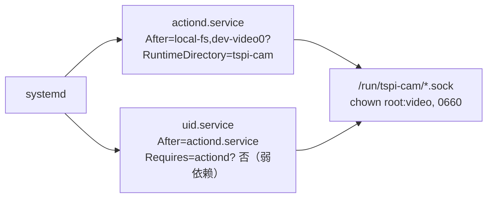

# tspi-cam 系统架构

- 状态：v1（2026-11-16）· 适用：泰山派 1M / RK3566 / Ubuntu 20.04 / 480×800 HDMI 触摸屏 / OV5695 MIPI / IMU660RB(SPI3)
- 参考：microduck（同 SoC、Rust 多守护进程）的**服务划分 + 单一 IPC 契约 + 每服务一 socket**；
  不照搬它的 WebRTC、更新器、BLE。
- 本文只拥有"服务怎么分、谁拥有什么、状态放哪"。线上契约见 [ipc.md](ipc.md)，crate 与 trait 见
  [interfaces.md](interfaces.md)，实测数据见 `../architecture.md` §16。

## 1. 形态

**两个守护进程 + 一个 CLI + 一个离线标定工具**，全部通过 Unix socket 讲同一份 JSON-RPC。

```text
   touchscreen ── evdev ──▶ uid ──┐                      (画面)
        ▲                          │  record.*            │ Xorg + libmali EGL + egui
        └──── HDMI/DRM ────────────┘  media.frame         ▼
                                 ┌───────────────────────────────┐
  你，在笔记本 or CLion ─▶ actionctl ─▶│ 每服务一个 socket · JSON-RPC 2.0 · 一行一个对象 │
                                 └───────┬───────────────┬───────┘
                                         ▼               ▼
                                  ┌────────────┐   ┌──────────────┐
                                  │  actiond   │   │  actioncal   │
                                  │ record.*   │   │ 独占设备时用  │
                                  │ 状态机      │   │ (CLI, flock) │
                                  │ 硬件唯一持有 │   └──────────────┘
                                  └──┬──┬──┬───┘
                    ┌────────────────┘  │  └──────────────┐
                    ▼                   ▼                 ▼
              /dev/video0          /dev/spidev3.0    /userdata/rec/
              (rkisp NV12)        (IMU660RB)         (video.mkv + csv + index.json)
```

| 服务 | 拥有 | 监听 | 只连 |
|---|---|---|---|
| `actiond` | **相机、IMU、硬件编码器、录制状态机、存储保护**；`record.*` | `/run/tspi-cam/record.sock` | `/dev/video0`、`/dev/spidev3.0`、`/dev/mpp_service`、`/userdata` |
| `uid` | 显示与触摸（HDMI 输出、evdev 触摸），**不碰任何采集设备** | 不监听（纯客户端） | `actiond`（`record.*` + `media.frame`） |
| `actionctl` | 无 | 无 | `actiond` |
| `actioncal` | 无（运行时）；离线标定文件 | 无 | `actiond` 的 `device.lock`（flock 互斥），然后独占硬件 |

**只有 `actiond` 碰相机、IMU、编码器。** 所有录制起停都是 intent：`uid`/`actionctl` 发请求，
`actiond` 状态机决定能不能执行（磁盘余量、设备是否可用、是否已在录）。

**`uid` 崩溃不停录。** 它是客户端，重启后重新订阅 `record.status` 即可；`actiond` 从不依赖 `uid`。
反过来 `uid` 允许依赖 `actiond`（没有 daemon 的 UI 只能显示"服务不可用"）。

**`actionctl` 必须在 `actiond` 挂掉时仍能工作**：它只讲协议，不加载编码/UI 栈。

## 2. 状态放哪

| 路径 | 内容 | 谁写 | 更新/回滚时 |
|---|---|---|---|
| `/etc/tspi-cam/recordd.toml` | **基础层**：安装器/镜像写的默认值（设备节点、分辨率、码率、队列、存储阈值） | 安装器 | 随安装包替换 |
| `/var/lib/tspi-cam/recordd.toml` | **用户层**：只写在这台设备上改过的键；读取时按表 key-by-key 合并覆盖基础层 | `actionctl configure` / `uid` | 升级、回滚都不动 |
| `/var/lib/tspi-cam/calibration.json` | 每台设备一份：内参、IMU 偏置、外参、时间偏移 | `actioncal` | 不动；`actiond` 启动时读入 |
| `/var/lib/tspi-cam/device.json` | 设备寿命记录：首次启动、累计录制裁数/时长、错误计数（microduck `vetbook` 同思路） | `actiond` | 不动 |
| `/run/tspi-cam/record.sock` | 控制/状态 socket，`0660 root:video` | `actiond` | 每次启动重建 |
| `/run/tspi-cam/media.sock` | 预览帧 socket（二进制帧 + JSON-RPC 头），`0660 root:video` | `actiond` | 每次启动重建 |
| `/run/tspi-cam/device.lock` | `flock` 独占锁：`actiond` 启动即持有，`actioncal` 抢锁 | 两者 | 内核释放，**文件残留不代表被占用** |
| `/userdata/rec/rec-*/` | 录制产物：`video.mkv`、`frames.csv`、`imu.csv`、`index.json` | `actiond` | 从不进升级包 |

安装布局（microduck 式，可回滚）：

```text
/opt/tspi-cam/releases/<version>/bin/{actiond,uid,actionctl,actioncal}
/opt/tspi-cam/current -> releases/<version>        # 原子切换，restart 生效
/etc/systemd/system/{actiond,uid}.service
/etc/sysusers.d/tspi-cam.conf                      # 服务账号 tspi-cam，加入 video 组
/etc/udev/rules.d/70-tspi-cam.rules                # /dev/spidev3.0、video4linux、mpp_service、dri
```

**只使用 releases 目录 + `current` 符号链接**，不做"先 `/usr/local/bin` 以后再说"——
两种布局并存会让"现在跑的是哪一版"变成一个需要猜的问题，而回滚是唯一必须在故障时还能用对的功能。
`actionctl` 是 `current/bin/actionctl` 的符号链接，升级后立即跟随新版本。

配置与录制数据路径与版本无关：`/etc/tspi-cam`、`/var/lib/tspi-cam`、`/userdata/rec` 不随 releases 移动。

## 3. 启动顺序与权限



- `actiond` 以**服务账号**（sysusers 建的 `tspi-cam`）运行，加入 `video` 组；**不使用 root**。
  设备访问全部由仓库内 `deploy/udev/70-tspi-cam.rules` 授权（当前 `/dev/spidev3.0` 是 `root:root 0600`，
  这正是必须补的规则）：

  ```udev
  # IMU660RB on SPI3
  KERNEL=="spidev3.0", GROUP="video", MODE="0660"
  # MPP / 显示 / 相机（板级镜像已有 video 组，这里显式固定，防止镜像改动）
  KERNEL=="mpp_service", GROUP="video", MODE="0660"
  SUBSYSTEM=="video4linux", GROUP="video", MODE="0660"
  KERNEL=="card[0-9]", SUBSYSTEM=="drm", GROUP="video", MODE="0660"
  KERNEL=="renderD*", SUBSYSTEM=="drm", GROUP="video", MODE="0660"
  ```

  规则写进仓库、由安装器安装并 `udevadm control --reload && udevadm trigger`；**不靠手工 chmod**
  （重启即失效，且不可复现）。录制目录 `/userdata/rec` 归 `tspi-cam` 服务账号所有。
- `uid` 以操作员账号 `k` 运行，通过 socket 组权限访问；它自己需要 `input` 组读触摸（或走 Xorg 的 pointer 事件）。
- `uid.service` 用 `After=actiond.service` + `Wants=`（不是 `Requires=`）：`actiond` 不在也不阻止 UI 起来报错。
- `RuntimeDirectory=tspi-cam` 负责 `/run/tspi-cam/` 的创建与清理；**socket 的 `0660` 与组属主写在
  daemon 里**（bind 后 `fchown`），不靠 umask。

## 4. 预览路径（与录制彻底隔离）

- 录制链路：`actiond` 内部多线程（采集→编码→写盘），**不经过 IPC**，`uid` 挂了不影响它。
- 预览链路：`actiond` 维护"最新一帧"槽（1 帧覆盖），`media.frame` 在**独立 socket** 上以
  `JSON-RPC 头 + 二进制负载` 发出，上限 10 fps；客户端慢就丢帧，**永不反压采集**。
  （microduck 同样把原始帧从控制通道里拿出去，因为一帧 1080p NV12 有 3–7 MB。）
- 预览格式：默认发 `NV12` 小图（由 encoder 前的 RGA/缩放产生，目标 480×800 面板），
  不让 `uid` 自己解码 5MP。**实测：编码器 1080p36fps / 5MP 30fps；预览缩放不能抢编码器的预算。**

## 5. 明确不做（Demo 边界）

- 不做板端稳像/推理；不做 WebRTC/远程控制；不做 BLE/NFC；不做 OTA 更新器与 A/B 镜像；
  不做多机器人、账号与云端。
- 不做 Wayland：显示走 Xorg + libmali EGL（实测 GLES 3.2 / Mali-G52，见
  `../research/ui-stack-decision.md`）。
- 不做"板上编译"：交叉编译在 PC（`deploy/build.sh`），板子只运行产物。
