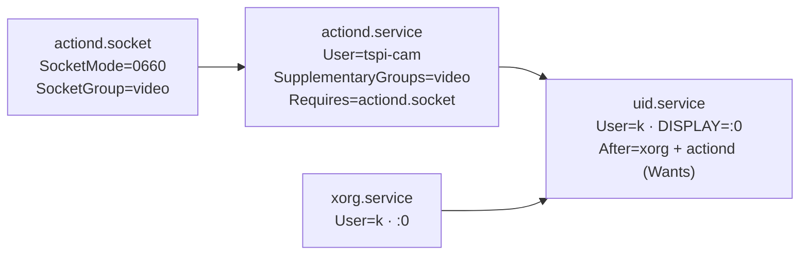

# tspi-cam 系统架构

- 状态：v1（2026-11-16）· 适用：泰山派 1M / RK3566 / Ubuntu 20.04 / 480×800 HDMI 触摸屏 / OV5695 MIPI / IMU660RB(SPI3)
- 参考：microduck（同 SoC、Rust 多守护进程）的**服务划分 + 单一 IPC 契约 + 每服务一 socket**；
  不照搬它的 WebRTC、更新器、BLE。
- 本文只拥有"服务怎么分、谁拥有什么、状态放哪"。线上契约见 [ipc.md](ipc.md)，crate 与 trait 见
  [interfaces.md](interfaces.md)，实测数据见 `../architecture.md` §16。

## 1. 形态

**两个守护进程 + 一个 CLI + 一个离线标定工具**，全部通过 Unix socket 讲同一份 JSON-RPC。

```text
  touchscreen ── USB HID ──▶ xorg(:0, user k) ── X11 pointer/XI2 ──▶ uid ──┐
        ▲                          │  (libinput 独占 evdev)                  │ record.*
        └──── HDMI/DRM ────────────┘  画面：libmali EGL + egui              │ media.frame
                                 ┌───────────────────────────────────┐      │
  你，在笔记本 or CLion ─▶ actionctl ─▶│ 每服务一个 socket · JSON-RPC 2.0 · NDJSON │◀──┘
                                 └──────┬────────────────┬───────────┘
                                        ▼                ▼
                                 ┌────────────┐   ┌──────────────┐
                                 │  actiond   │   │  actioncal   │
                                 │ record.*   │   │ 独占设备时用  │
                                 │ 状态机/唯一 │   │ (CLI, flock) │
                                 │ 硬件持有者   │   └──────────────┘
                                 └──┬──┬──┬───┘
                   ┌───────────────┘  │  └──────────────┐
                   ▼                  ▼                 ▼
             /dev/video0        /dev/spidev3.0    /userdata/rec/
             (rkisp NV12)       (IMU660RB)        (video.mkv + csv + index.json)
```

| 服务 | 拥有 | 监听 | 只连 |
|---|---|---|---|
| `actiond` | **相机、IMU、硬件编码器、录制状态机、存储保护**；`record.*` | `/run/tspi-cam/record.sock` | `/dev/video0`、`/dev/spidev3.0`、`/dev/mpp_service`、`/userdata` |
| `xorg` | **显示与输入**：HDMI 480×800@60、libinput 独占触摸 evdev；以操作员账号 `k` 运行 | `:0`（X socket） | `/dev/dri/card0`、`/dev/input/event*` |
| `uid` | UI 进程：X11 客户端 + egui + libmali EGL；**不读 evdev、不碰采集设备** | 不监听（纯客户端） | `actiond`（`record.*` + `media.frame`）、`xorg`（`DISPLAY=:0`） |
| `actionctl` | 无 | 无 | `actiond` |
| `actioncal` | 无（运行时）；离线标定文件 | 无 | `actiond` 的 `device.lock`（flock 互斥），然后独占硬件 |

**只有 `actiond` 碰相机、IMU、编码器。** 所有录制起停都是 intent：`uid`/`actionctl` 发请求，
`actiond` 状态机决定能不能执行（磁盘余量、设备是否可用、是否已在录）。

**`uid` 崩溃不停录。** 它是客户端，重启后重新订阅 `record.status` 即可；`actiond` 从不依赖 `uid`。
反过来 `uid` 允许依赖 `actiond`（没有 daemon 的 UI 只能显示"服务不可用"）。

**触摸只有一条路径**：`xorg` 经 libinput 独占 `/dev/input/event*`，`uid` 从 X11 拿 pointer/XI2
事件（实测 Xorg 会 grab 设备，第二个 evdev 读者收不到事件）。`uid` 因此**不需要 `input` 组**，
需要 `video` 组（连 `actiond` 的 socket）与 `DISPLAY=:0`。

**`actionctl` 必须在 `actiond` 挂掉时仍能工作**：它只讲协议，不加载编码/UI 栈。

## 2. 状态放哪

| 路径 | 内容 | 谁写 | 更新/回滚时 |
|---|---|---|---|
| `/etc/tspi-cam/recordd.toml` | **基础层**：安装器/镜像写的默认值（设备节点、分辨率、码率、队列、存储阈值） | 安装器 | 随安装包替换 |
| `/var/lib/tspi-cam/recordd.toml` | **用户层**：只写在这台设备上改过的键；读取时按表 key-by-key 合并覆盖基础层 | `actionctl configure` / `uid` | 升级、回滚都不动 |
| `/var/lib/tspi-cam/calibration.json` | 每台设备一份：内参、IMU 偏置、外参、时间偏移 | `actioncal` | 不动；`actiond` 启动时读入 |
| `/var/lib/tspi-cam/device.json` | 设备寿命记录：首次启动、累计录制裁数/时长、错误计数（microduck `vetbook` 同思路） | `actiond` | 不动 |
| `/run/tspi-cam/record.sock` | 控制/状态 socket，`0660 root:video` | systemd（`actiond.socket`） | 由 socket unit 管理 |
| `/run/tspi-cam/media.sock` | 预览帧 socket（二进制帧 + JSON-RPC 头），`0660 root:video` | systemd（`actiond.socket`） | 由 socket unit 管理 |
| `/run/tspi-cam/device.lock` | `flock` 独占锁：`actiond` 启动即持有，`actioncal` 抢锁 | 两者 | 内核释放，**文件残留不代表被占用** |
| `/userdata/rec/rec-*/` | 录制产物：`video.mkv`、`frames.csv`、`imu.csv`、`index.json` | `actiond` | 从不进升级包 |

安装与升级（细节归 [deploy.md](deploy.md)；本节只定所有权）：

```text
/opt/tspi-cam/releases/<version>/bin/{actiond,uid,actionctl,actioncal}
/opt/tspi-cam/releases/<version>/systemd/{actiond.service,actiond.socket,uid.service}
/opt/tspi-cam/current -> releases/<version>
/etc/systemd/system/{actiond.service,actiond.socket,uid.service}   # 安装器写入，指向 current/bin
/etc/sysusers.d/tspi-cam.conf     # u tspi-cam；m tspi-cam video
/etc/udev/rules.d/70-tspi-cam.rules
```

- **切换原子**：`ln -s releases/<v> current.tmp && mv -T current.tmp current`（同一文件系统上的 rename，
  没有 unlink 窗口）。保留 `current` + 上一个版本，回滚 = 反向 rename + `systemctl restart`；
  其余旧版本在健康检查通过后清理。
- **unit 文件不进 release 的 symlink**：`/etc/systemd/system/*.service` 指向 `current/bin/*`，
  因此切换版本不需要 `daemon-reload`；若某版本必须改 unit，安装器负责写入并 reload，且这一步
  不算回滚安全点（写进 deploy.md 的升级检查表）。
- 配置与录制数据路径与版本无关：`/etc/tspi-cam`、`/var/lib/tspi-cam`、`/userdata/rec` 不随 releases 移动。

## 3. 启动顺序与权限



- **socket 由 systemd 创建，daemon 不自建、不 chown**。`actiond.socket` 声明
  `ListenStream=/run/tspi-cam/record.sock` 与 `.../media.sock`、`SocketMode=0660`、
  `SocketUser=root`、`SocketGroup=video`；`actiond` 以 `tspi-cam` 身份 `accept` 传入的 fd。
  理由：非 root 的 `actiond` **不可能** `chown` 成 `root:video`（实测 EPERM），而 `RuntimeDirectory`
  又保证目录属主是 `tspi-cam`；socket activation 让"属主"和"运行身份"解耦。
- 客户端 `connect()` 需要 socket 的**写**权限，所以 `0660` 是下限，`0640` 连不上（unix(7)）。
- **组**：安装器把操作员加入 `video`（`usermod -aG video k`），`k` 需要重新登录才生效；`actiond`
  通过 `SupplementaryGroups=video` 拿到设备权限。`xorg` 同样以 `k` 运行，需要 `video`（DRM）与
  `input`（evdev）——`input` 只给 Xorg，`uid` 不需要。
- 设备访问全部由 `deploy/udev/70-tspi-cam.rules` 授权（当前 `/dev/spidev3.0` 是 `root:root 0600`）：

  ```udev
  KERNEL=="spidev3.0", GROUP="video", MODE="0660"
  KERNEL=="mpp_service", GROUP="video", MODE="0660"
  SUBSYSTEM=="video4linux", GROUP="video", MODE="0660"
  KERNEL=="media[0-9]*", SUBSYSTEM=="media", GROUP="video", MODE="0660"
  KERNEL=="card[0-9]", SUBSYSTEM=="drm", GROUP="video", MODE="0660"
  KERNEL=="renderD*", SUBSYSTEM=="drm", GROUP="video", MODE="0660"
  KERNEL=="rga", GROUP="video", MODE="0660"
  ```

  `spidev3.0` 开机时不存在（H5：driver_override 不持久），节点由 `spidev-bind.service` 创建后才
  出现，因此该规则只能对"后出现"的设备生效：`actiond.service` 要 `After=spidev-bind.service`
  （`Wants=`，失败不阻塞启动，`record.status` 报 `E_HW` 缺 IMU）。
- `actioncal` 以 `k`（`video` 组）运行，与 `actiond` 抢 `device.lock`；标定期间 `actiond` 释放硬件。
- **根目录/录制目录**：`/userdata/rec` 归 `tspi-cam`，`/var/lib/tspi-cam` 归 `tspi-cam`；
  `/etc/tspi-cam` 由安装器写、daemon 只读。

## 4. 预览路径（与录制彻底隔离）

- 录制链路：`actiond` 内部多线程（采集→编码→写盘），**不经过 IPC**，`uid` 挂了不影响它。
- 预览链路：`actiond` 维护"最新一帧"槽（1 帧覆盖），`media.frame` 在**独立 socket** 上以
  `JSON-RPC 头 + 二进制负载` 发出，上限 10 fps；客户端慢就丢帧，**永不反压采集**。
  （microduck 同样把原始帧从控制通道里拿出去，因为一帧 1080p NV12 有 3–7 MB。）
- 预览格式：默认发 `NV12` 小图（由 encoder 前的 RGA/缩放产生，目标 480×800 面板），
  不让 `uid` 自己解码 5MP。**实测：编码器 1080p36fps / 5MP 30fps；预览缩放不能抢编码器的预算。**

## 5. 明确不做（Demo 边界）

- 不做板端稳像/推理；不做 WebRTC/远程控制；不做 BLE/NFC；不做 OTA 更新器与 A/B 镜像；
  不做多机器人、账号与云端。
- 不做 Wayland：显示走 Xorg + libmali EGL（实测 GLES 3.2 / Mali-G52，见
  `../research/ui-stack-decision.md`）。
- 不做"板上编译"：交叉编译在 PC（`deploy/build.sh`），板子只运行产物。
