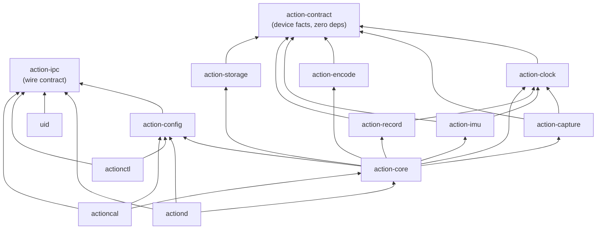

# tspi-cam crate 边界与接口

- 状态：v1（2026-11-16）· 本文拥有"crate 怎么分、trait 长什么样、谁依赖谁"。
  线上协议见 [ipc.md](ipc.md)，服务划分见 [architecture.md](architecture.md)。
- 原则（来自知识库 `Rust 学习/契约层与机器门禁`）：
  1. **契约层只放"会因换器件而变"的事实**（传感器模式、步幅、帧尺寸、编码器上限），每条带出处；
  2. 策略参数（队列深度、码率、阈值）一律进配置层；
  3. 依赖方向由 `cargo xtask arch` 判定，不靠人看。

## 1. Workspace 划分

| crate | 类型 | 拥有 | 允许依赖 |
|---|---|---|---|
| `action-ipc` | lib | **线上契约**：`Call`、方法名、错误码、socket 常量、帧头 | serde, serde_json, semver |
| `action-config` | lib | 配置 schema、默认值、分层合并、`configure` 校验 | ipc（错误码）, serde, toml |
| `action-contract` | lib | **器件事实**：传感器模式表、帧尺寸/步幅、编码器实测上限（带出处注释） | 无（零依赖） |
| `action-clock` | lib | `MonoTime`、驱动时间戳 → 单调时钟、抖动统计 | contract |
| `action-capture` | lib | V4L2 采集（选定格式/分辨率、dmabuf/mmap、取帧、时间戳） | contract, clock |
| `action-encode` | lib | MPP 编码封装（H.264/H.265、步幅对齐、包输出） | contract |
| `action-imu` | lib | SPI IMU 采样（LSM6DSR，逐字节读、ODR 208、单位换算） | contract, clock |
| `action-record` | lib | 写盘：MKV 视频/CSV/`index.json`、Drain/Flush/Finalize | contract, clock |
| `action-storage` | lib | 余量检查、目录分配、清理策略 | contract |
| `action-core` | lib | **装配层**：把上面几个拼成"录制会话"，含线程与有界队列 | 以上全部 |
| `actiond` | bin | 服务：状态机、IPC server、设备锁、订阅推送 | core, ipc, config |
| `uid` | bin | UI：Xorg/egui 渲染、触摸、预览订阅 | ipc |
| `actionctl` | bin | CLI：所有 `Call` 的薄客户端 | ipc, config |
| `actioncal` | bin | 离线标定：抢锁、采数据、写 `calibration.json` | core, contract, config |
| `xtask` | bin | 门禁与打包：`arch/docs/ipc/smoke/size` | 无（只读仓库） |

依赖方向（`action-ipc` 与 `action-contract` 位于最底层，谁都不许反向依赖）：



**禁止**：`action-ipc`/`action-contract` 依赖任何其它 workspace crate；`action-core` 依赖 `actiond`；
任何 lib 依赖二进制 crate 或 UI 库。门禁见 §6。

## 2. 契约层（`action-contract`）

只写会因"换一块板/换一个 sensor"而变的事实，且每条给来源：

```rust
/// IMU660RB = LSM6DSR 家族。WHO_AM_I(0x0F) 期望 0x6B。来源：器件手册 + 板上实测 H3。
pub const IMU_WHO_AM_I_REG: u8 = 0x0F;
pub const IMU_WHO_AM_I: u8 = 0x6B;
/// 硬件 ODR 档位：LSM6DSR 无 200 Hz，最近档为 208 Hz。来源：手册表 + H3/H6 实测。
pub const IMU_ODR_HZ: u32 = 208;

/// OV5695 当前 BSP 只暴露一个模式：2592×1944@30（media-ctl 实测 H14）。
pub const SENSOR_MODE_W: u32 = 2592;
pub const SENSOR_MODE_H: u32 = 1944;
pub const SENSOR_FPS: u32 = 30;

/// NV12 = w*h + w*h/2。编译期断言：换分辨率时不会悄悄算错队列字节数。
pub const fn nv12_len(w: u32, h: u32) -> usize { (w as usize) * (h as usize) * 3 / 2 }
const _: () = assert!(nv12_len(2592, 1944) == 7_552_272); // = 60 帧 186_624_000 B / 60（H9 实测）
const _: () = assert!(nv12_len(1920, 1080) == 3_110_400); // H9 实测
```

编码器上限（实测 H12/H15）也放这里，但只放"能力上限"，不放"本次选什么码率"：

```rust
/// MPP VEPU2 实测吞吐上限（`mpph264enc`，H15）。策略分辨率由配置层决定。
pub const ENC_FPS_CEIL_1080P: u32 = 36;
pub const ENC_FPS_CEIL_720P: u32 = 81;
pub const ENC_FPS_CEIL_5MP: u32 = 30;   // H12/H16：2592×1944 实测 30.045 fps
```

## 3. 采集与编码接口（零拷贝是契约的一部分）

```rust
/// 单调时钟，纳秒。全系统只有一个时间域（CLOCK_MONOTONIC）。
#[derive(Copy, Clone, PartialEq, Eq, PartialOrd, Ord, Debug)]
pub struct MonoTime(pub u64);

pub enum TsSource { Sof, Eof, Dequeue } // MIPI 语义待 H13 核实后固定

pub trait Timebase: Send + Sync {
    fn now(&self) -> MonoTime;
    /// 驱动时间戳 → 单调时钟；offset 由启动时测一次中值并记录在 index.json。
    fn from_driver(&self, raw: i64, src: TsSource) -> MonoTime;
}

pub struct Geometry { pub w: u32, pub h: u32 }
pub enum PixelFormat { Nv12 }

/// 驱动缓冲的借用：`Drop` 时归还 V4L2 队列，不复制。
pub struct FrameLease<'a> {
    pub id: u64,
    pub pts: MonoTime,
    pub geom: Geometry,
    pub format: PixelFormat,
    pub stride: u32,          // 16 对齐；2592→2560 之外的步幅会触发 RGA 回退，见 capture-encode.md
    pub planes: [&'a [u8]; 2],
    _owner: &'a mut dyn FrameOwner,
}

pub trait FrameSource: Send {
    fn start(&mut self, geom: Geometry, fps: u32) -> Result<SourceInfo, CaptureError>;
    /// 阻塞至多 `timeout`；超时返回 `None`（不是错误）。
    fn next_frame(&mut self, timeout: std::time::Duration) -> Result<Option<FrameLease<'_>>, CaptureError>;
    fn stop(&mut self);
    fn info(&self) -> SourceInfo;   // 实际格式/步幅/驱动时间戳语义
}

pub struct EncoderConfig { pub codec: Codec, pub geom: Geometry, pub bitrate_kbps: u32, pub gop: u32 }
pub enum Codec { H264, H265 }
pub struct EncodedPacket { pub pts: MonoTime, pub keyframe: bool, pub data: Vec<u8> }

pub trait VideoEncoder: Send {
    fn open(cfg: &EncoderConfig) -> Result<Self, EncodeError> where Self: Sized;
    fn submit(&mut self, frame: &FrameLease<'_>) -> Result<(), EncodeError>;
    fn poll(&mut self, timeout: std::time::Duration) -> Result<Option<EncodedPacket>, EncodeError>;
    fn flush(&mut self) -> Result<(), EncodeError>;
}
```

约束（写成注释 + 门禁，不靠自觉）：

- **编码器不得持有 `FrameLease` 超过 `submit` 调用**；需要异步时由 `actiond` 的复制策略决定（默认不复制，MPP 直接消费 dmabuf）。
- 采集分辨率白名单与 `Geometry` 校验在 `action-config`，不在采集器里。
- `FrameLease` 只能有一个所有者：采集线程生产、编码线程消费，**队列深度 ≤ 8 且按时间预算 267 ms**（H9/H16）。

## 4. IMU 接口

```rust
pub struct ImuSample {
    pub t: MonoTime,          // t_spi_read；M2 起可换成 t_drdy
    pub gyro: [f32; 3],       // rad/s
    pub accel: [f32; 3],      // m/s²
    pub raw: [i16; 6],        // 原始 LSB，保留以便离线重算
}

pub trait ImuSource: Send {
    fn open(&mut self, spi: &str, odr_hz: u32) -> Result<ImuInfo, ImuError>;
    fn read(&mut self) -> Result<ImuSample, ImuError>;
    /// 采样时刻的估计（用于抖动统计）：返回 (t_read, t_estimate)
    fn last_timing(&self) -> (MonoTime, MonoTime);
}
```

**硬约束**：单字节读（H6：多字节自增读在本板返回错数据）；`odr_hz` 由配置给（默认 208），
换算系数进 `action-contract`。

## 5. 写盘接口

```rust
pub struct RecordConfig {
    pub dir: std::path::PathBuf,       // /userdata/rec
    pub geom: Geometry,
    pub codec: Codec,
    pub bitrate_kbps: u32,
    pub headroom_mb: u64,
}

pub struct Recorder { /* ... */ }

impl Recorder {
    pub fn begin(cfg: RecordConfig) -> Result<(Self, RecId), RecordError>;
    pub fn video(&mut self, pkt: &EncodedPacket) -> Result<(), RecordError>;
    pub fn imu(&mut self, s: &ImuSample) -> Result<(), RecordError>;
    /// Drain → fsync → 写 index.json.tmp → rename → fsync(dir)
    pub fn finish(self) -> Result<Index, RecordError>;
    pub fn abort(self) -> Index;  // 尽力落盘，标记 complete=false
}
```

- 视频与 IMU 各有独立 thread/文件句柄（§5.2 隔离规则），`Recorder` 只暴露线程安全的写入方法。
- `Index` 字段见 `record-format.md`（待写）；`complete` 是唯一"记录完整"标志。

## 6. 门禁（`cargo xtask`，单一构建入口）

| 子命令 | 检查 | 负向验证（必须能红） |
|---|---|---|
| `xtask arch` | `cargo tree` 依赖方向 + 禁止项列表 | 给 `action-ipc` 加一个 workspace 依赖 → 红 |
| `xtask ipc` | [ipc.md](ipc.md) §7 四条 | 删掉某个 lane 或 `deny_unknown_fields` → 红 |
| `xtask docs` | 每个机制有且只有一页 owner；链接有效 | 在两页重复写同一机制 → 红 |
| `xtask smoke` | 在板上跑 `record.status`/`record.start` 5 s/`record.stop`，核对帧数、index.json、退出码 | 把 `record.sock` 指到不存在路径 → 明确的 `E_IPC`，不是超时 |
| `xtask size` | 产物大小上限（board 板 6 GB rootfs 约束） | — |

规则：**新加一条检查，必须故意制造一次违规看到红，再撤销**（知识库同款要求）。
